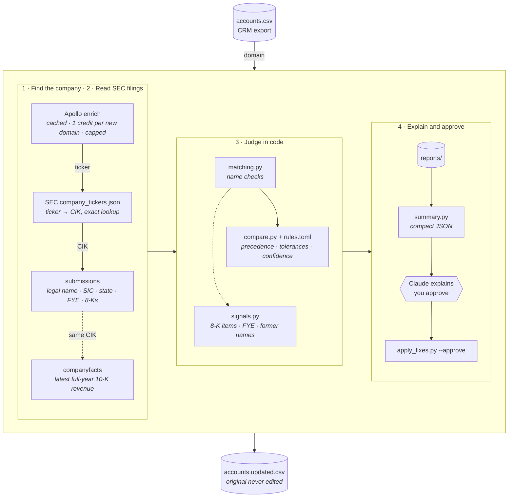

# apollo-sec-audit

An Agent Skill that audits CRM account records against **Apollo** enrichment and **SEC EDGAR** filings. It proposes evidence-backed fixes and surfaces buying signals from SEC filings. A person approves every change.

## What it does

For each account in a CRM export (`account_id, name, domain, annual_revenue, hq_state, industry, employees`), the skill:

1. **Finds the company.**
   - CRM domain → Apollo organization.
   - Apollo's ticker → SEC filer, by exact lookup. A name check guards both hops.
2. **Checks four fields** (revenue, HQ state, industry, employees) against SEC for public companies and Apollo otherwise. Each field gets a status (`ok`, `missing`, `conflict`, `unverified`), a confidence level set by rules, and a one-line rationale with a link to the filing.
3. **Proposes fixes.**
   - High-confidence (SEC) and medium-confidence (Apollo) fixes go to `proposed_fixes.csv`.
   - Low-confidence items go to `needs_review.csv` and are never proposed.
4. **Adds what the CRM doesn't have:** legal name, fiscal year end, former names, and the last 12 months of 8-Ks for executive changes (5.02), acquisitions (2.01), restructurings (2.05) and material agreements (1.01).
5. **Applies only approved rows,** to a copy of the CRM file.

Why that matters to a revenue team, with every claim sourced or labeled as a hypothesis: [docs/value-case.md](docs/value-case.md).

**One-pager:** [docs/one-pager.md](docs/one-pager.md). **Demo (5 min or less):** _Loom link to be added._

## Quick start

Requirements: Python 3.12.

```bash
python -m venv .venv
source .venv/bin/activate        # macOS/Linux
# .venv\Scripts\activate         # Windows (PowerShell or cmd)
pip install -e ".[dev]"
cp .env.example .env             # set SEC_USER_AGENT="Your Name you@example.com"
```

Every command below assumes the environment is active.

`APOLLO_API_KEY` is needed only for live Apollo calls (one credit each).

**As a skill.** Open Claude Code in this repo and ask it to "audit my CRM accounts". It follows [`skills/crm-account-audit/SKILL.md`](skills/crm-account-audit/SKILL.md):

1. Dry run.
2. Ask before spending credits.
3. Summarize the results.
4. Apply only the fixes you name.

To install the skill elsewhere, copy the `skills/crm-account-audit` folder into a skills directory Claude Code reads.

**As scripts,** from the repo root:

```bash
python skills/crm-account-audit/scripts/audit.py                  # dry run: no Apollo calls
python skills/crm-account-audit/scripts/audit.py --live           # fetch uncached domains (credits)
python skills/crm-account-audit/scripts/summary.py                # compact JSON of what needs attention
python skills/crm-account-audit/scripts/apply_fixes.py --approve A001:annual_revenue
```

Outputs:

- `reports/`: `audit.json`, `proposed_fixes.csv`, `needs_review.csv`, `signals.csv`.
- `data/accounts.updated.csv`: the approved changes. `data/accounts.csv` is never edited.

Tests run offline (network blocked): `pytest`. Lint and types: `ruff check . && mypy`.

## Sample output

From `data/accounts.csv`: 12 real companies with fake CRM values and 10 planted errors. Apollo's own values are left out here, because the repo is public ([ADR 0001](docs/adr/0001-fixtures-from-real-responses.md)).

```text
$ python skills/crm-account-audit/scripts/audit.py
12 accounts; 0 domains not in the Apollo cache.
Apollo live calls this run: 0
Wrote reports: 12 proposed fixes, 6 for review, 60 signals, 0 account errors.
```

| Account | Field | CRM → proposed | Confidence | Rationale (abridged) |
|---|---|---|---|---|
| HubSpot | annual_revenue | 2,200,000,000 → 3,131,266,000 | high | SEC 10-K revenue for the year ending 2025-12-31; CRM differs by 30%. [filing](https://www.sec.gov/Archives/edgar/data/1404655/000119312526046646/) |
| Salesforce | hq_state | WA → CA | high | SEC business address state CA. |
| NVIDIA | annual_revenue | 130,497,000,000 → 215,938,000,000 | high | SEC 10-K revenue for the year ending 2026-01-25; CRM differs by 40%. [filing](https://www.sec.gov/Archives/edgar/data/1045810/000104581026000021/) |
| Walmart | industry | (blank) → Retail | high | SEC SIC 5331 (Retail-Variety Stores) maps to Retail. |
| Chipotle | industry | Retail → Restaurants | **low: review** | SEC SIC 5812; industry conflicts always go to a person. |
| Delta Air Lines | domain | deltafaucet.com | **low: review** | Apollo returned a different company (name check 59.3); the CRM domain is likely wrong. |

All 10 planted errors were caught. Three findings were real rather than planted:

- `google.com` has no ticker in Apollo, because the listed company is the parent, Alphabet.
- Apollo's headcount for Chick-fil-A looks like corporate staff only.
- Apollo lists Google's founded year as 2010; it was 1998.

Details: [docs/probe-notes.md](docs/probe-notes.md).

## How it works



### Design decisions

- **Skill, not just a script or a raw MCP call.**
  - The scripts do every judgment deterministically: matching, precedence, tolerances, confidence.
  - The skill adds what a script can't: explaining results in plain language, asking before spending credits, and turning "approve HubSpot's revenue" into one exact command.
  - A raw MCP or API call would leave the matching and confidence rules to the model on every run.

- **Rules are data.** Precedence, tolerances, name thresholds and 8-K items live in [`rules.toml`](skills/crm-account-audit/scripts/rules.toml); SIC → industry lives in [`sic_industry.csv`](skills/crm-account-audit/scripts/sic_industry.csv). See [ADR 0004](docs/adr/0004-audit-rules.md).
- **The model reads a trimmed, typed summary,** never raw API responses: 15 KB instead of 40 KB on the sample. Even filing counts are pre-computed ([ADR 0007](docs/adr/0007-trimmed-structured-model-input.md)).
- **Ticker-only SEC matching.** No CIK is ever guessed from a name. The name check runs against SEC's legal and former names ([ADR 0005](docs/adr/0005-ticker-matching-and-name-check.md)).
- **SEC revenue is the latest full-year 10-K value across all revenue concepts.** Taking the first concept found gave HubSpot's 2017 revenue ([ADR 0002](docs/adr/0002-sec-annual-revenue-selection.md)).
- **Credits are guarded.**
  - The cache is read first.
  - Dry run is the default.
  - Live calls are hard-capped, and corrupt cache files raise instead of refetching ([ADR 0003](docs/adr/0003-apollo-credit-guardrails.md)).

- **Writes go to a copy.** Each approved row must still match the CRM value the audit saw. Earlier rounds and reviewer entries are never overwritten ([ADR 0006](docs/adr/0006-write-back-to-a-copy.md)).

**Deliberately left out of v1:**

- private-company SEC lookups (Form D)
- a live CRM write
- contacts
- reading filing text

See "What I'd do next".

## Assumptions

- The CRM export has one row per account, with the seven columns above. The domain is the company's main website.
- **SEC is authoritative** for revenue, legal name, HQ state and industry (SIC). Apollo is authoritative only for employees. Apollo values are estimates, so they are capped at medium confidence.
- **HQ means the SEC business address,** not the state of incorporation.
- Apollo's industry label is self-reported, so industry comes from SIC codes: SEC's for public companies, Apollo's `sic_codes` otherwise. Apollo documents both facts ([probe notes](docs/probe-notes.md)).
- **US accounts only.** Non-US states are `unverified`, never guessed.
- A person reviews every proposed change. Medium-confidence fixes in particular need a sanity check.

## Where AI helped, and where I didn't trust it

I built this with Claude Code. It wrote most of the code and tests; I set the direction, reviewed every PR, and approved every merge. Four moments show where its output needed checking.

**Two I caught myself:**

1. **Industry vocabulary.** The AI proposed leaving private-company industry "unverified", because Apollo's industry labels don't match SEC's. I accepted the reasoning, but asked it to check whether Apollo maps its labels to SIC codes first. Apollo's help pages block automated readers, so the AI couldn't confirm what search results claimed. I saved the pages by hand. They showed two things:
   - Apollo's industry is "a self-reported, single value pulled from company social media sites".
   - Its per-company `sic_codes` use SEC's SIC vocabulary.

   The design changed: private-company industry now comes from Apollo's SIC codes at medium confidence ([ADR 0004](docs/adr/0004-audit-rules.md), [probe notes](docs/probe-notes.md)).
2. **"How is the domain used if we're going off tickers?"** The design said SEC matching is "ticker-only", and I asked what that meant for the CRM domain. The answer made the full chain explicit: domain → Apollo organization → its ticker → SEC. "Ticker-only" covers only the last hop, so a wrong CRM domain reaches the wrong company. The sample's `deltafaucet.com` for Delta Air Lines is exactly that case. A name check already guarded it. The question added an optional CRM ticker column to "What I'd do next".

**Two caught in review, by checking claims against real data instead of trusting the plan:**

1. **The revenue trap.** The written plan said to check SEC revenue concepts in a fixed order. Run against a live SEC response, that order returned HubSpot's 2017 revenue ($375.6M) instead of its current revenue ($3.13B): eight years stale and about 8× too low. The rule became "latest full-year 10-K value across all concepts" ([ADR 0002](docs/adr/0002-sec-annual-revenue-selection.md)).
2. **A popular statistic, rejected.** Sales content often claims new executives make 60–70% of their vendor decisions in their first 90 days. Researching the value case, we couldn't trace it to any study, so it isn't used. The executive-change signal is labeled a hypothesis, with a way for Apollo to measure it ([docs/value-case.md](docs/value-case.md)).

**How AI output was checked in general:**
- every behavior has an offline test
- a hand-written golden harness states the expected result for each case
- deliberate rule changes (mutation checks) confirm the tests catch them
- two AI reviews (code and security) run before each PR, and a third (CodeRabbit) after
- a fresh session tested the skill using only `SKILL.md`
- live data checked every field name before any code relied on it ([probe notes](docs/probe-notes.md))

## What was pre-existing

Nothing. Everything here was built for this exercise. It reuses public APIs (Apollo organization enrichment, SEC EDGAR) and standard libraries (`requests`, `rapidfuzz`, `pytest`, `responses`). The test fixtures started from one real Apollo response and real SEC responses. Apollo's values were then replaced with fake ones ([ADR 0001](docs/adr/0001-fixtures-from-real-responses.md)).

## How it was checked

- **342 offline tests.**
  - `pytest-socket` blocks the network, and `responses` fakes HTTP.
  - A hand-written golden harness ([`tests/golden/cases.json`](tests/golden/cases.json)) states the expected status and confidence for each case.
  - Mutation checks confirmed that changing a rule fails the cases it should.

- **Two live runs.** One Apollo probe, and one 11-credit run on the sample, 13 of 85 credits in total. All 10 planted errors were caught at the expected confidence.
- **A cold test.** A fresh Claude Code session that saw only `SKILL.md` ran the whole flow. Its report was checked line by line against `summary.py` output, and the one error it made (a miscount) moved counting into code.
- **Reviews on every PR.**
  - CI runs ruff, ruff format, mypy strict and pytest. CodeQL also runs.
  - Before each PR: `/code-review` and `/security-review`. After: a CodeRabbit review.
  - A person approves every merge.

## What I'd harden for production

- **Pin GitHub Actions to commit SHAs.** CI uses tags (`actions/checkout@v4`). A moved or compromised tag would run new code in CI.
- **Lock dependency versions.** `pyproject.toml` uses `>=` ranges with no lock file, so two installs can differ. Use a lock file (e.g. `uv lock` or `pip-tools`) and update it on purpose.
- **Live contract tests.** Fixtures are snapshots ([ADR 0001](docs/adr/0001-fixtures-from-real-responses.md)). If Apollo or SEC change a field, offline tests still pass. Run a scheduled job that calls each API once and checks the fields we read still exist.
- **GitHub Code Quality.** Not enabled: its billing for public repos was unclear, and ruff, mypy, CodeQL and CodeRabbit already cover most of it. Revisit with a paid plan.
- **Cache expiry.** Cached responses never expire ([ADR 0003](docs/adr/0003-apollo-credit-guardrails.md)). SEC's ticker list and filings change daily, so a long-lived cache misses new 8-Ks. Give SEC entries a TTL (e.g. one day) and Apollo entries a longer one tied to the credit budget.
- **Retries with backoff.** A 429 or 5xx fails the account at once. Retry SEC calls with backoff; retry Apollo only within the credit cap.
- **File locking for concurrent runs.** Two `apply_fixes` runs on the same files at once can still lose an edit or an output ([ADR 0006](docs/adr/0006-write-back-to-a-copy.md)). A lock that every writer honors would close that; a single user running one command at a time never hits it.
- **Shared rate limit.** The SEC throttle is per process. Two runs at once could exceed 10 requests per second. Use a shared limiter if runs go parallel.
- **Stronger name check.** `token_set_ratio` passes subsets ("Apple" vs "Apple Hospitality REIT"; [ADR 0005](docs/adr/0005-ticker-matching-and-name-check.md)). Add a second signal, such as `token_sort_ratio` or the HQ state, before trusting the match.
- **Paid CodeRabbit tier.** The free tier allows about one review per hour. So minor findings that don't change a PR's behavior are deferred to the next step's PR, where they're fixed test-first, instead of waiting an hour for a re-review. The PR thread names the PR that fixes each one. With a paid tier, fix and re-review in the same PR.

## What I'd do next

- **Private companies through SEC Form D.** Private companies have no ticker, so linking them to an SEC filer means matching by name, and a wrong match is worse than no match. Doing it safely needs a check on name, state and funding date, with weak matches sent to review. That didn't fit the timebox.
- **Parent and subsidiary linking.** Apollo has no ticker for `google.com`; the listed parent is Alphabet. Linking a brand domain to its listed parent needs a source for corporate hierarchy (Apollo's bulk enrich mentions hierarchy data; not yet verified).
- **Optional ticker column in the CRM.** Today the chain is CRM domain → Apollo organization → its ticker → SEC, so a wrong domain reaches the wrong company (the sample's `deltafaucet.com` for Delta Air Lines). Many CRMs already store tickers; using one directly would skip the domain hop for public accounts. The CRM-vs-Apollo name check would still guard the domain path.
- **Write to a live CRM.** v1 writes approved fixes to a copy of the CSV ([ADR 0006](docs/adr/0006-write-back-to-a-copy.md)). A CRM integration needs the same guards (approval, current-value check) plus the CRM's own audit trail.
- **Contacts.** Executive changes (5.02) name the people involved. Linking them to Apollo contacts would turn a signal into an outreach list, but that adds people data and its privacy rules.
- **Reading filing text.** Today an 8-K is reported by item code and link. Summarizing the filing itself (who left, what was acquired) is a good job for the model, with the filing as its only input.
- **International companies.** v1 treats only US states as state evidence. Non-US addresses are `unverified`, never guessed. Apollo doesn't aim to cover international companies fully, so this needs its own scoping.
- **Confirm how Apollo assigns SIC codes.** Apollo says it "determines SIC and NAICS codes from multiple sources" ([probe notes](docs/probe-notes.md)). Until that's clearer, Apollo-derived industry stays at medium confidence.

## Decision records

[`docs/adr/`](docs/adr/):

1. fixtures from real responses
2. SEC revenue selection
3. Apollo credit guardrails
4. audit rules
5. ticker matching and the name check
6. write-back to a copy
7. trimmed model input
